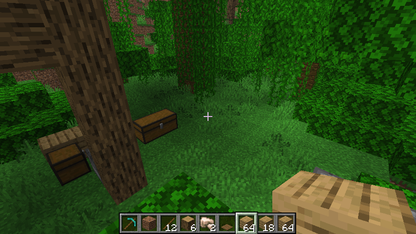
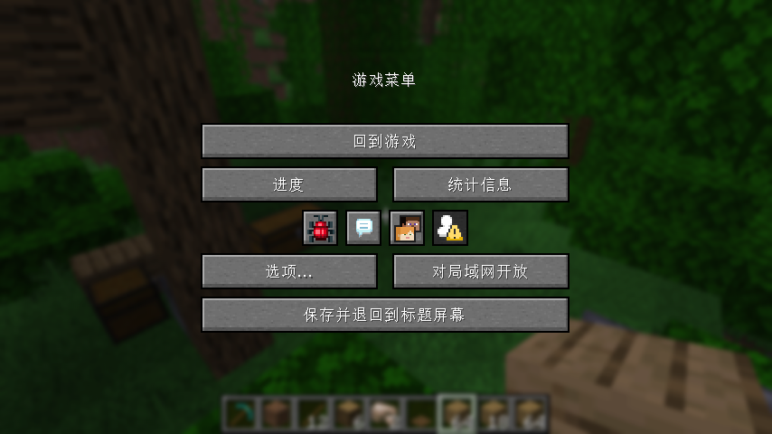

# NoAutoPause

一个**独立**的 Fabric 客户端模组：关掉 Minecraft 的自动暂停，窗口失去焦点时游戏照常运行。

这是从 [MineAgentAIO](https://github.com/MineAgent/MineAgentAIO) 里**抽出来的单一功能**——AIO 把
HTTP 控制接口和「后台不暂停」放在同一个 jar 里，这个仓库只保留后者，方便单独使用 / 单独调试 /
单独复用（例如别的自动化客户端模组只想要这一个行为）。

* 模组 id：`noautopause`
* 环境：客户端（`environment: client`）
* 依赖：**只有 Fabric Loader**，不需要 Fabric API，也不需要其他模组
* 对应 Minecraft：**26.2**（26.1 起官方代码不再混淆，构建不需要 mappings）

## 行为

每个客户端 tick 检查一次，把 `Minecraft.options.pauseOnLostFocus` 置为 `false`（**只做一次**）。
效果就是：Alt-Tab / 切到别的窗口 / 无人看管时，**单人存档不会自动暂停**，游戏继续 tick。

只动这一个开关，所以**没有改变原版的其他暂停语义**：单人存档里按 ESC 打开菜单、切到 LAN 菜单
等等，仍然照常暂停游戏。

## 实现

不依赖 Fabric API。上游 [noautopause](https://github.com/Armandukx/noautopause) 1.0.2 用的是
`ClientTickEvents.END_CLIENT_TICK`，那样必须依赖 `fabric-api`；这里改成自己注入
`Minecraft#tick`：

```
src/main/java/com/mineagent/noautopause/
  NoAutoPause.java               清一次 pauseOnLostFocus=false（逻辑本体，不碰 mixin）
  NoAutoPauseMod.java            ClientModInitializer，只在日志里报告版本
  mixin/MinecraftMixin.java      @Inject(method = "tick()V", at = @At("TAIL"))
```

`NoAutoPause#tick` 的守卫与上游的 `AppliedSetting` 标志一致：只写一次，之后每次 tick 直接返回。

## 构建

需要 JDK 25（Minecraft 26.2 要求）。

```bash
./gradlew build          # 产物: build/libs/noautopause-1.0.0.jar
```

把 `build/libs/noautopause-1.0.0.jar`（不是 `-sources.jar`）丢进 `~/.minecraft/mods/` 即可。

## 验证

启动游戏后，日志里会出现：

```
noautopause: pauseOnLostFocus=false (the client keeps running while unfocused)
```

在游戏里把窗口切到后台、等几秒再切回来：单人存档不会弹出「游戏已暂停」的菜单，世界时间继续走。

用 `--quickPlaySingleplayer test` 直接进单人存档，在 Linux + X11 上实测。
先故意把 `options.txt` 里的 `pauseOnLostFocus` 写成 `true`（否则这个测试没有意义——开关本来就是关的），
再用一个多余的 X 窗口把输入焦点从游戏窗口抢走，然后读 `/ctl/mouse` 和 `/aif/world`：

| 测试 | 结果 |
| --- | --- |
| 启动（mods 里只有本模组 + Fabric Loader + 那几个 HTTP 模组，**没有 Fabric API**） | 无 mixin 报错，日志出现 `NoAutoPause 1.0.0 loaded` |
| 第一次 tick（`options.txt` 里 `pauseOnLostFocus:true`） | 日志 `noautopause: pauseOnLostFocus=false (the client keeps running while unfocused)` |
| 失焦后（**装**本模组） | `界面：无`、`抓取：是`，`游戏刻` 从 175351 涨到 175528（约 9 秒 ≈ 177 tick），画面照常是游戏内视角 → 世界没有暂停 |
| 失焦后（同一实例**不装**本模组，`pauseOnLostFocus:true`） | 500ms 后 `界面：PauseScreen`、`抓取：否` → 原版行为确实会暂停，证明上面那组不是「失焦没生效」 |
| 正常退出时落盘的 `options.txt` | `pauseOnLostFocus:false`（是模组写进去的那个值） |

两张截图（同一次失焦，唯一的差别是装没装本模组）：

| 装本模组 | 不装本模组 |
| --- | --- |
|  |  |

## 与 MineAgentAIO 的关系

代码同源：`MineAgentAIO` 里的 `com.mineagent.aio.NoAutoPause` + `MinecraftMixin` 的对应注入，
原样搬到这里的 `com.mineagent.noautopause.*`。

* 两边**可以同时装**：AIO 用的是自己的模组 id 和 mixin 配置，不冲突（重复设置同一个开关是无害的）。
* 如果 mods 里已经有上游的 `noautopause-1.0.2.jar`，**不要和本模组同时放**：两者模组 id 都是
  `noautopause`，Fabric 会在启动时因为 id 重复而报错。二选一即可。

## 许可与来源

* **代码**：LGPL-3.0-only，完整文本见 [`LICENSE`](LICENSE)（其中引用的 GPL-3.0 见
  [`LICENSE.GPL-3.0`](LICENSE.GPL-3.0)）；源码文件头部标有 `SPDX-License-Identifier: LGPL-3.0-only`。
* **文档**：CC BY-NC-SA 4.0。
* 行为改编自 [Armandukx/noautopause](https://github.com/Armandukx/noautopause) 1.0.2
  （作者 Armandukx，MIT / CC0-1.0）。详见 [`NOTICE.md`](NOTICE.md)。
